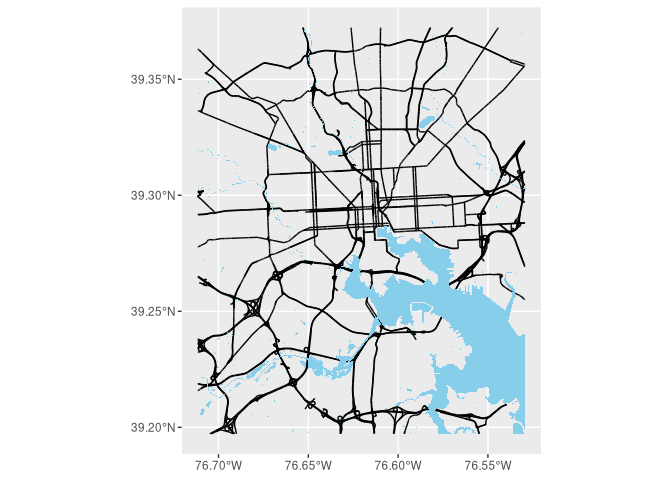

# OSM data backup
Camille Seaberry

Sometimes the OSM servers are down. It’s free and volunteer-run, so
that’s understandable. You can download the same data as a geopackage
from a variety of sources (also other formats). This is also what you’d
do if you wanted to run your own server that uses OSM data, like for
hosting a geocoder (I do this) or vector tilemaps. Within the US, you
can download individual states, or regions, or the country. I downloaded
Maryland’s data from
[Geofabrik](https://download.geofabrik.de/north-america/us.html); it’s
430MB zipped, so I can’t put it in the notes repo but it should be easy
enough to download on a decent internet connection. (That also means I
can’t execute the code that builds these notes online. The output here
is from a local run.)

There are 20 layers in the geopackage file, matching (some of?) the keys
that you can find in the OSM wiki. Use `sf::st_read` to read layers you
want from the file, or use a SQL-style query to subset it and save time
& memory. Then you’ll have an `sf` object you can plot like normal.

``` r
library(ggplot2)
library(sf)

path <- here::here("assets/maryland-261109-free.gpkg.zip")
sf::st_layers(path)
```

| name | geomtype | driver | features | fields | crs |
|:---|:---|:---|---:|---:|:---|
| gis_osm_traffic_free | Point | GPKG | 130627 | 5 | WGS 84 (CRS84) , GEOGCRS\[“WGS 84 (CRS84)”, |

    DATUM["World Geodetic System 1984",
        ELLIPSOID["WGS 84",6378137,298.257223563,
            LENGTHUNIT["metre",1]]],
    PRIMEM["Greenwich",0,
        ANGLEUNIT["degree",0.0174532925199433]],
    CS[ellipsoidal,2],
        AXIS["geodetic longitude (Lon)",east,
            ORDER[1],
            ANGLEUNIT["degree",0.0174532925199433]],
        AXIS["geodetic latitude (Lat)",north,
            ORDER[2],
            ANGLEUNIT["degree",0.0174532925199433]],
    ID["OGC","CRS84"]] |

\|gis_osm_places_free \|Point \|GPKG \| 4937\| 5\|WGS 84 (CRS84) ,
GEOGCRS\[“WGS 84 (CRS84)”, DATUM\[“World Geodetic System 1984”,
ELLIPSOID\[“WGS 84”,6378137,298.257223563, LENGTHUNIT\[“metre”,1\]\]\],
PRIMEM\[“Greenwich”,0, ANGLEUNIT\[“degree”,0.0174532925199433\]\],
CS\[ellipsoidal,2\], AXIS\[“geodetic longitude (Lon)”,east, ORDER\[1\],
ANGLEUNIT\[“degree”,0.0174532925199433\]\], AXIS\[“geodetic latitude
(Lat)”,north, ORDER\[2\], ANGLEUNIT\[“degree”,0.0174532925199433\]\],
ID\[“OGC”,“CRS84”\]\] \| \|gis_osm_pois_free \|Point \|GPKG \| 40576\|
4\|WGS 84 (CRS84) , GEOGCRS\[“WGS 84 (CRS84)”, DATUM\[“World Geodetic
System 1984”, ELLIPSOID\[“WGS 84”,6378137,298.257223563,
LENGTHUNIT\[“metre”,1\]\]\], PRIMEM\[“Greenwich”,0,
ANGLEUNIT\[“degree”,0.0174532925199433\]\], CS\[ellipsoidal,2\],
AXIS\[“geodetic longitude (Lon)”,east, ORDER\[1\],
ANGLEUNIT\[“degree”,0.0174532925199433\]\], AXIS\[“geodetic latitude
(Lat)”,north, ORDER\[2\], ANGLEUNIT\[“degree”,0.0174532925199433\]\],
ID\[“OGC”,“CRS84”\]\] \| \|gis_osm_transport_free \|Point \|GPKG \|
11381\| 4\|WGS 84 (CRS84) , GEOGCRS\[“WGS 84 (CRS84)”, DATUM\[“World
Geodetic System 1984”, ELLIPSOID\[“WGS 84”,6378137,298.257223563,
LENGTHUNIT\[“metre”,1\]\]\], PRIMEM\[“Greenwich”,0,
ANGLEUNIT\[“degree”,0.0174532925199433\]\], CS\[ellipsoidal,2\],
AXIS\[“geodetic longitude (Lon)”,east, ORDER\[1\],
ANGLEUNIT\[“degree”,0.0174532925199433\]\], AXIS\[“geodetic latitude
(Lat)”,north, ORDER\[2\], ANGLEUNIT\[“degree”,0.0174532925199433\]\],
ID\[“OGC”,“CRS84”\]\] \| \|gis_osm_natural_free \|Point \|GPKG \|
55350\| 4\|WGS 84 (CRS84) , GEOGCRS\[“WGS 84 (CRS84)”, DATUM\[“World
Geodetic System 1984”, ELLIPSOID\[“WGS 84”,6378137,298.257223563,
LENGTHUNIT\[“metre”,1\]\]\], PRIMEM\[“Greenwich”,0,
ANGLEUNIT\[“degree”,0.0174532925199433\]\], CS\[ellipsoidal,2\],
AXIS\[“geodetic longitude (Lon)”,east, ORDER\[1\],
ANGLEUNIT\[“degree”,0.0174532925199433\]\], AXIS\[“geodetic latitude
(Lat)”,north, ORDER\[2\], ANGLEUNIT\[“degree”,0.0174532925199433\]\],
ID\[“OGC”,“CRS84”\]\] \| \|gis_osm_pofw_free \|Point \|GPKG \| 2055\|
4\|WGS 84 (CRS84) , GEOGCRS\[“WGS 84 (CRS84)”, DATUM\[“World Geodetic
System 1984”, ELLIPSOID\[“WGS 84”,6378137,298.257223563,
LENGTHUNIT\[“metre”,1\]\]\], PRIMEM\[“Greenwich”,0,
ANGLEUNIT\[“degree”,0.0174532925199433\]\], CS\[ellipsoidal,2\],
AXIS\[“geodetic longitude (Lon)”,east, ORDER\[1\],
ANGLEUNIT\[“degree”,0.0174532925199433\]\], AXIS\[“geodetic latitude
(Lat)”,north, ORDER\[2\], ANGLEUNIT\[“degree”,0.0174532925199433\]\],
ID\[“OGC”,“CRS84”\]\] \| \|gis_osm_roads_free \|Line String \|GPKG \|
924591\| 10\|WGS 84 (CRS84) , GEOGCRS\[“WGS 84 (CRS84)”, DATUM\[“World
Geodetic System 1984”, ELLIPSOID\[“WGS 84”,6378137,298.257223563,
LENGTHUNIT\[“metre”,1\]\]\], PRIMEM\[“Greenwich”,0,
ANGLEUNIT\[“degree”,0.0174532925199433\]\], CS\[ellipsoidal,2\],
AXIS\[“geodetic longitude (Lon)”,east, ORDER\[1\],
ANGLEUNIT\[“degree”,0.0174532925199433\]\], AXIS\[“geodetic latitude
(Lat)”,north, ORDER\[2\], ANGLEUNIT\[“degree”,0.0174532925199433\]\],
ID\[“OGC”,“CRS84”\]\] \| \|gis_osm_railways_free \|Line String \|GPKG \|
5836\| 7\|WGS 84 (CRS84) , GEOGCRS\[“WGS 84 (CRS84)”, DATUM\[“World
Geodetic System 1984”, ELLIPSOID\[“WGS 84”,6378137,298.257223563,
LENGTHUNIT\[“metre”,1\]\]\], PRIMEM\[“Greenwich”,0,
ANGLEUNIT\[“degree”,0.0174532925199433\]\], CS\[ellipsoidal,2\],
AXIS\[“geodetic longitude (Lon)”,east, ORDER\[1\],
ANGLEUNIT\[“degree”,0.0174532925199433\]\], AXIS\[“geodetic latitude
(Lat)”,north, ORDER\[2\], ANGLEUNIT\[“degree”,0.0174532925199433\]\],
ID\[“OGC”,“CRS84”\]\] \| \|gis_osm_waterways_free \|Line String \|GPKG
\| 48405\| 5\|WGS 84 (CRS84) , GEOGCRS\[“WGS 84 (CRS84)”, DATUM\[“World
Geodetic System 1984”, ELLIPSOID\[“WGS 84”,6378137,298.257223563,
LENGTHUNIT\[“metre”,1\]\]\], PRIMEM\[“Greenwich”,0,
ANGLEUNIT\[“degree”,0.0174532925199433\]\], CS\[ellipsoidal,2\],
AXIS\[“geodetic longitude (Lon)”,east, ORDER\[1\],
ANGLEUNIT\[“degree”,0.0174532925199433\]\], AXIS\[“geodetic latitude
(Lat)”,north, ORDER\[2\], ANGLEUNIT\[“degree”,0.0174532925199433\]\],
ID\[“OGC”,“CRS84”\]\] \| \|gis_osm_buildings_a_free \|Multi Polygon
\|GPKG \| 1928862\| 5\|WGS 84 (CRS84) , GEOGCRS\[“WGS 84 (CRS84)”,
DATUM\[“World Geodetic System 1984”, ELLIPSOID\[“WGS
84”,6378137,298.257223563, LENGTHUNIT\[“metre”,1\]\]\],
PRIMEM\[“Greenwich”,0, ANGLEUNIT\[“degree”,0.0174532925199433\]\],
CS\[ellipsoidal,2\], AXIS\[“geodetic longitude (Lon)”,east, ORDER\[1\],
ANGLEUNIT\[“degree”,0.0174532925199433\]\], AXIS\[“geodetic latitude
(Lat)”,north, ORDER\[2\], ANGLEUNIT\[“degree”,0.0174532925199433\]\],
ID\[“OGC”,“CRS84”\]\] \| \|gis_osm_traffic_a_free \|Multi Polygon \|GPKG
\| 30989\| 5\|WGS 84 (CRS84) , GEOGCRS\[“WGS 84 (CRS84)”, DATUM\[“World
Geodetic System 1984”, ELLIPSOID\[“WGS 84”,6378137,298.257223563,
LENGTHUNIT\[“metre”,1\]\]\], PRIMEM\[“Greenwich”,0,
ANGLEUNIT\[“degree”,0.0174532925199433\]\], CS\[ellipsoidal,2\],
AXIS\[“geodetic longitude (Lon)”,east, ORDER\[1\],
ANGLEUNIT\[“degree”,0.0174532925199433\]\], AXIS\[“geodetic latitude
(Lat)”,north, ORDER\[2\], ANGLEUNIT\[“degree”,0.0174532925199433\]\],
ID\[“OGC”,“CRS84”\]\] \| \|gis_osm_landuse_a_free \|Multi Polygon \|GPKG
\| 84630\| 4\|WGS 84 (CRS84) , GEOGCRS\[“WGS 84 (CRS84)”, DATUM\[“World
Geodetic System 1984”, ELLIPSOID\[“WGS 84”,6378137,298.257223563,
LENGTHUNIT\[“metre”,1\]\]\], PRIMEM\[“Greenwich”,0,
ANGLEUNIT\[“degree”,0.0174532925199433\]\], CS\[ellipsoidal,2\],
AXIS\[“geodetic longitude (Lon)”,east, ORDER\[1\],
ANGLEUNIT\[“degree”,0.0174532925199433\]\], AXIS\[“geodetic latitude
(Lat)”,north, ORDER\[2\], ANGLEUNIT\[“degree”,0.0174532925199433\]\],
ID\[“OGC”,“CRS84”\]\] \| \|gis_osm_water_a_free \|Multi Polygon \|GPKG
\| 26033\| 4\|WGS 84 (CRS84) , GEOGCRS\[“WGS 84 (CRS84)”, DATUM\[“World
Geodetic System 1984”, ELLIPSOID\[“WGS 84”,6378137,298.257223563,
LENGTHUNIT\[“metre”,1\]\]\], PRIMEM\[“Greenwich”,0,
ANGLEUNIT\[“degree”,0.0174532925199433\]\], CS\[ellipsoidal,2\],
AXIS\[“geodetic longitude (Lon)”,east, ORDER\[1\],
ANGLEUNIT\[“degree”,0.0174532925199433\]\], AXIS\[“geodetic latitude
(Lat)”,north, ORDER\[2\], ANGLEUNIT\[“degree”,0.0174532925199433\]\],
ID\[“OGC”,“CRS84”\]\] \| \|gis_osm_pois_a_free \|Multi Polygon \|GPKG \|
45180\| 4\|WGS 84 (CRS84) , GEOGCRS\[“WGS 84 (CRS84)”, DATUM\[“World
Geodetic System 1984”, ELLIPSOID\[“WGS 84”,6378137,298.257223563,
LENGTHUNIT\[“metre”,1\]\]\], PRIMEM\[“Greenwich”,0,
ANGLEUNIT\[“degree”,0.0174532925199433\]\], CS\[ellipsoidal,2\],
AXIS\[“geodetic longitude (Lon)”,east, ORDER\[1\],
ANGLEUNIT\[“degree”,0.0174532925199433\]\], AXIS\[“geodetic latitude
(Lat)”,north, ORDER\[2\], ANGLEUNIT\[“degree”,0.0174532925199433\]\],
ID\[“OGC”,“CRS84”\]\] \| \|gis_osm_places_a_free \|Multi Polygon \|GPKG
\| 89\| 5\|WGS 84 (CRS84) , GEOGCRS\[“WGS 84 (CRS84)”, DATUM\[“World
Geodetic System 1984”, ELLIPSOID\[“WGS 84”,6378137,298.257223563,
LENGTHUNIT\[“metre”,1\]\]\], PRIMEM\[“Greenwich”,0,
ANGLEUNIT\[“degree”,0.0174532925199433\]\], CS\[ellipsoidal,2\],
AXIS\[“geodetic longitude (Lon)”,east, ORDER\[1\],
ANGLEUNIT\[“degree”,0.0174532925199433\]\], AXIS\[“geodetic latitude
(Lat)”,north, ORDER\[2\], ANGLEUNIT\[“degree”,0.0174532925199433\]\],
ID\[“OGC”,“CRS84”\]\] \| \|gis_osm_natural_a_free \|Multi Polygon \|GPKG
\| 452\| 4\|WGS 84 (CRS84) , GEOGCRS\[“WGS 84 (CRS84)”, DATUM\[“World
Geodetic System 1984”, ELLIPSOID\[“WGS 84”,6378137,298.257223563,
LENGTHUNIT\[“metre”,1\]\]\], PRIMEM\[“Greenwich”,0,
ANGLEUNIT\[“degree”,0.0174532925199433\]\], CS\[ellipsoidal,2\],
AXIS\[“geodetic longitude (Lon)”,east, ORDER\[1\],
ANGLEUNIT\[“degree”,0.0174532925199433\]\], AXIS\[“geodetic latitude
(Lat)”,north, ORDER\[2\], ANGLEUNIT\[“degree”,0.0174532925199433\]\],
ID\[“OGC”,“CRS84”\]\] \| \|gis_osm_pofw_a_free \|Multi Polygon \|GPKG \|
2550\| 4\|WGS 84 (CRS84) , GEOGCRS\[“WGS 84 (CRS84)”, DATUM\[“World
Geodetic System 1984”, ELLIPSOID\[“WGS 84”,6378137,298.257223563,
LENGTHUNIT\[“metre”,1\]\]\], PRIMEM\[“Greenwich”,0,
ANGLEUNIT\[“degree”,0.0174532925199433\]\], CS\[ellipsoidal,2\],
AXIS\[“geodetic longitude (Lon)”,east, ORDER\[1\],
ANGLEUNIT\[“degree”,0.0174532925199433\]\], AXIS\[“geodetic latitude
(Lat)”,north, ORDER\[2\], ANGLEUNIT\[“degree”,0.0174532925199433\]\],
ID\[“OGC”,“CRS84”\]\] \| \|gis_osm_transport_a_free \|Multi Polygon
\|GPKG \| 393\| 4\|WGS 84 (CRS84) , GEOGCRS\[“WGS 84 (CRS84)”,
DATUM\[“World Geodetic System 1984”, ELLIPSOID\[“WGS
84”,6378137,298.257223563, LENGTHUNIT\[“metre”,1\]\]\],
PRIMEM\[“Greenwich”,0, ANGLEUNIT\[“degree”,0.0174532925199433\]\],
CS\[ellipsoidal,2\], AXIS\[“geodetic longitude (Lon)”,east, ORDER\[1\],
ANGLEUNIT\[“degree”,0.0174532925199433\]\], AXIS\[“geodetic latitude
(Lat)”,north, ORDER\[2\], ANGLEUNIT\[“degree”,0.0174532925199433\]\],
ID\[“OGC”,“CRS84”\]\] \| \|gis_osm_protected_areas_a_free \|Multi
Polygon \|GPKG \| 2981\| 3\|WGS 84 (CRS84) , GEOGCRS\[“WGS 84 (CRS84)”,
DATUM\[“World Geodetic System 1984”, ELLIPSOID\[“WGS
84”,6378137,298.257223563, LENGTHUNIT\[“metre”,1\]\]\],
PRIMEM\[“Greenwich”,0, ANGLEUNIT\[“degree”,0.0174532925199433\]\],
CS\[ellipsoidal,2\], AXIS\[“geodetic longitude (Lon)”,east, ORDER\[1\],
ANGLEUNIT\[“degree”,0.0174532925199433\]\], AXIS\[“geodetic latitude
(Lat)”,north, ORDER\[2\], ANGLEUNIT\[“degree”,0.0174532925199433\]\],
ID\[“OGC”,“CRS84”\]\] \| \|gis_osm_adminareas_a_free \|Multi Polygon
\|GPKG \| 655\| 4\|WGS 84 (CRS84) , GEOGCRS\[“WGS 84 (CRS84)”,
DATUM\[“World Geodetic System 1984”, ELLIPSOID\[“WGS
84”,6378137,298.257223563, LENGTHUNIT\[“metre”,1\]\]\],
PRIMEM\[“Greenwich”,0, ANGLEUNIT\[“degree”,0.0174532925199433\]\],
CS\[ellipsoidal,2\], AXIS\[“geodetic longitude (Lon)”,east, ORDER\[1\],
ANGLEUNIT\[“degree”,0.0174532925199433\]\], AXIS\[“geodetic latitude
(Lat)”,north, ORDER\[2\], ANGLEUNIT\[“degree”,0.0174532925199433\]\],
ID\[“OGC”,“CRS84”\]\] \|

``` r
balt_sf <- justviz::tracts_sf |>
    dplyr::filter(county == "Baltimore city") |>
    sf::st_union() |>
    sf::st_bbox() |>
    sf::st_as_sfc()

balt_roads <- sf::st_read(
    path,
    # don't need layer since there's a query
    # layer = "gis_osm_roads_free",
    query = '
        SELECT * 
        FROM "gis_osm_roads_free" 
        WHERE fclass IN ("motorway", "trunk", "motorway_link", "trunk_link", "primary", "primary_link")'
) |>
    sf::st_transform(4269) |>
    sf::st_crop(balt_sf)
```

    Reading query `
            SELECT * 
            FROM "gis_osm_roads_free" 
            WHERE fclass IN ("motorway", "trunk", "motorway_link", "trunk_link", "primary", "primary_link")'
    from data source `/home/camille/code/ges778/assets/maryland-261109-free.gpkg.zip' 
      using driver `GPKG'
    Simple feature collection with 37529 features and 10 fields
    Geometry type: LINESTRING
    Dimension:     XY
    Bounding box:  xmin: -79.49997 ymin: 37.98263 xmax: -75.05203 ymax: 39.90312
    Geodetic CRS:  WGS 84 (CRS84)

``` r
balt_water_polys <- sf::st_read(path, layer = "gis_osm_water_a_free") |>
    sf::st_transform(4269) |>
    sf::st_crop(balt_sf)
```

    Reading layer `gis_osm_water_a_free' from data source 
      `/home/camille/code/ges778/assets/maryland-261109-free.gpkg.zip' 
      using driver `GPKG'
    Simple feature collection with 26033 features and 4 fields
    Geometry type: MULTIPOLYGON
    Dimension:     XY
    Bounding box:  xmin: -79.49913 ymin: 37.73386 xmax: -75.05222 ymax: 39.8276
    Geodetic CRS:  WGS 84 (CRS84)

``` r
ggplot() +
    geom_sf(data = balt_roads) +
    geom_sf(data = balt_water_polys, color = NA, fill = "skyblue")
```


